<div align="center">

# 🏢 Society Manager

**A full-stack mobile app that runs a housing society's visitors, dues, complaints and notices.
Any society can sign up and start using it in a few minutes.**


[**📱 Download the APK**](#-try-it-yourself) · [**✨ Features**](#-features) · [**🏗️ Architecture**](#️-architecture) · [**🧠 Engineering highlights**](#-engineering-highlights)

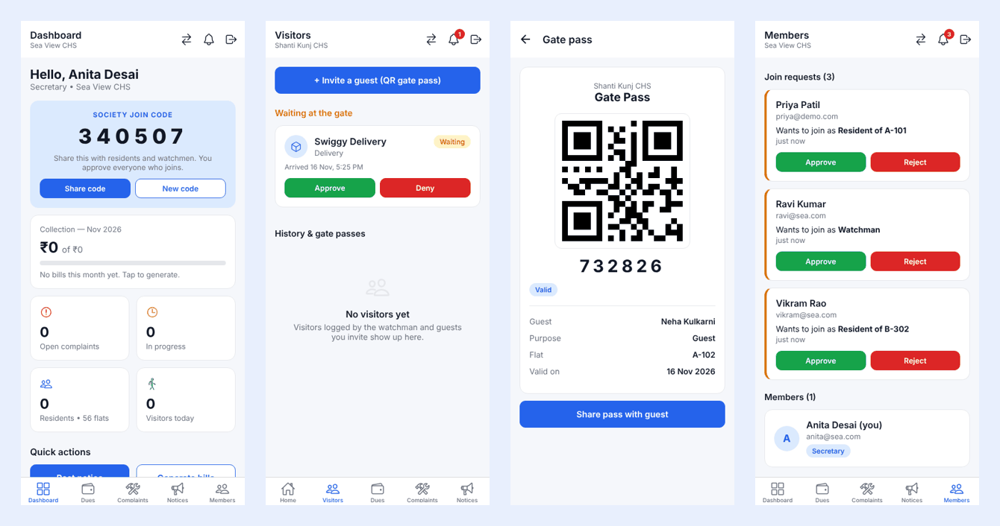

</div>

---

## 💡 The problem

Most cooperative housing societies in Mumbai still run on **WhatsApp groups and paper registers**:

- The watchman writes visitors in a notebook and **calls the flat on the intercom** to ask whether to let them in.
- Maintenance bills are collected in cash and tracked in an Excel sheet, and **receipts get lost**.
- Complaints like "the lift is stuck again" get buried in a WhatsApp group with 200 messages.
- Important notices (water cuts, AGMs) are missed.

**Society Manager puts all of this in one app**, with a separate experience for each of the three people
involved: the **resident**, the **watchman** at the gate, and the **society secretary**.

---

## ✨ Features

### 🔐 Built for every society (multi-tenant)
- A **secretary creates the society** by entering its name, address and building layout (wings × floors × flats).
  The app generates every flat (`A-101 … B-704`) and a **6-digit join code**.
- **Residents and watchmen join with the code.** The secretary gets a notification and **approves or rejects** each request.
- **One account can belong to several societies**, for example someone who owns one flat and rents another,
  and switch between them in one tap.
- Each society's data is completely isolated from every other society.

### 👤 Three roles, three experiences

| 🏠 Resident | 🛡️ Watchman | 💼 Secretary |
|---|---|---|
| Approve or deny visitors at the gate from the phone | Log walk-in visitors (the flat is notified instantly) | Dashboard: collection progress, complaints, visitors today |
| Invite guests with a **QR gate pass** shared on WhatsApp | **Scan the QR pass** with the camera, or type the 6-digit code | Share or regenerate the society join code |
| Pay maintenance and download a **PDF receipt** | Allow entry and mark exit, with a live "who's inside" log | **Approve or reject join requests**, remove members |
| Raise complaints **with a photo** and track their status | Read the notice board | Generate monthly bills for all flats in one tap |
| Notice board and in-app notifications | | Update complaint status and post notices to everyone |

### 📸 Screenshots

| Create a society | Secretary dashboard | Join with code | Approve members |
|:---:|:---:|:---:|:---:|
| 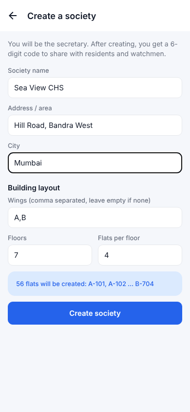 | 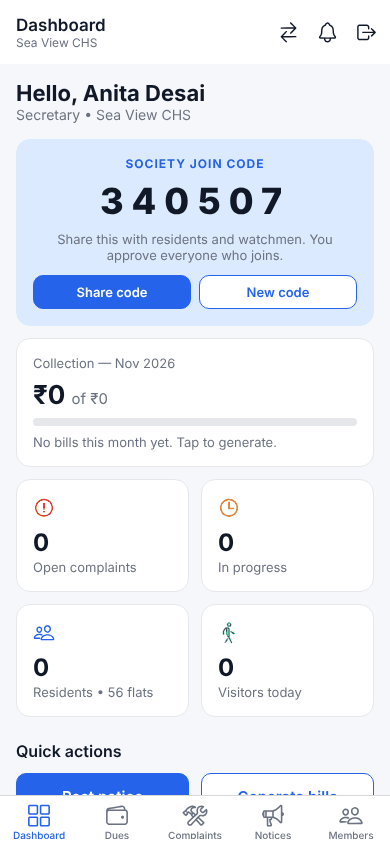 | 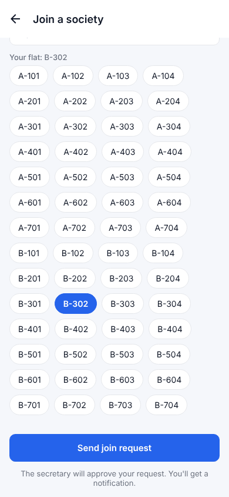 | 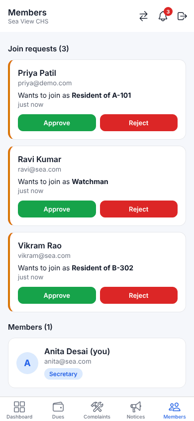 |

| Watchman logs a visitor | Resident approves | Guest QR pass | Pass verified at gate |
|:---:|:---:|:---:|:---:|
| 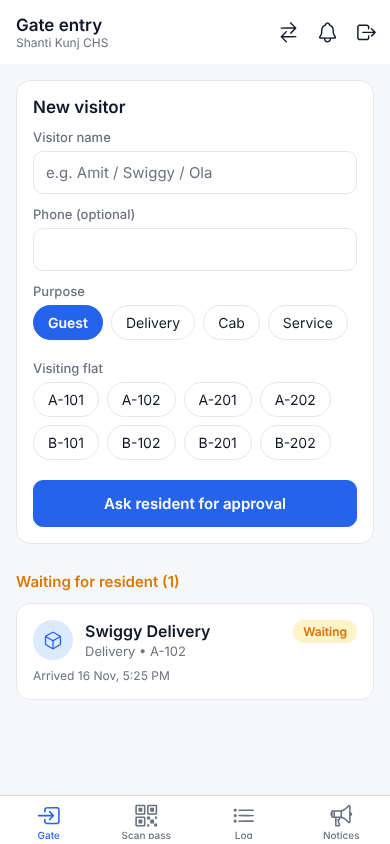 | 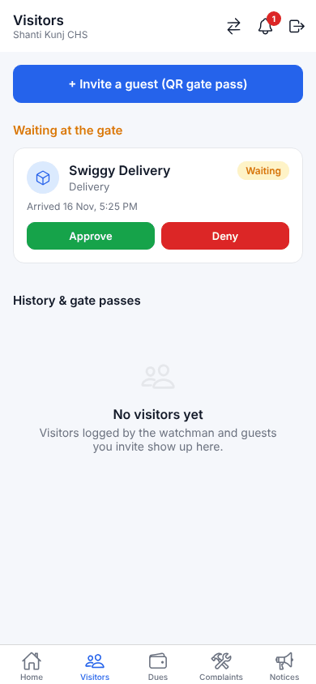 | 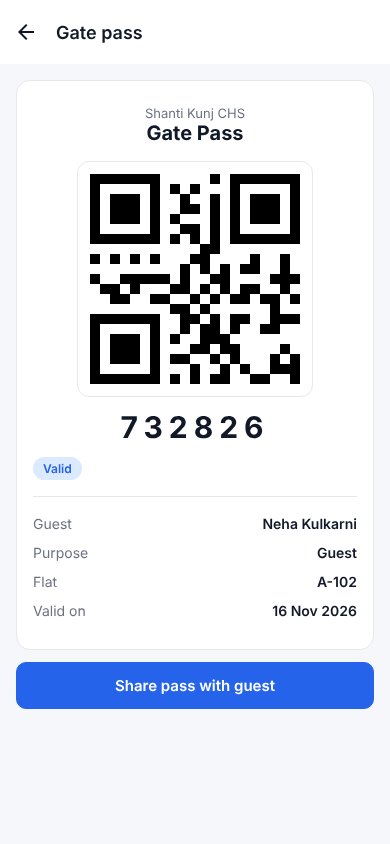 | 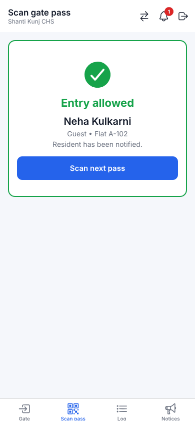 |

| Maintenance & receipts | Complaint tracking | Multiple societies | Login |
|:---:|:---:|:---:|:---:|
| 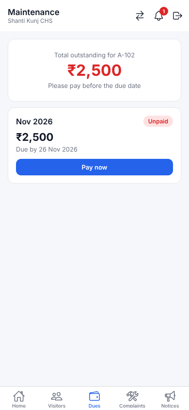 | 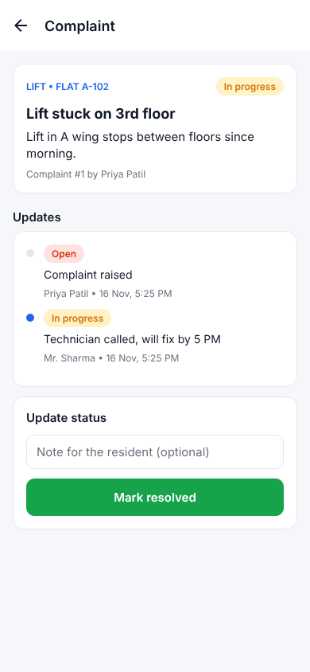 | 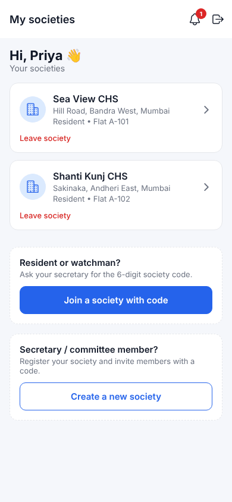 | 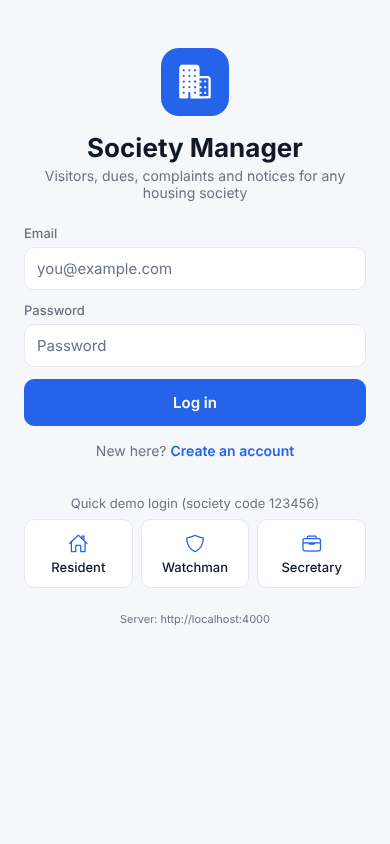 |

---

## 🎬 How a visitor gets in: the core flow

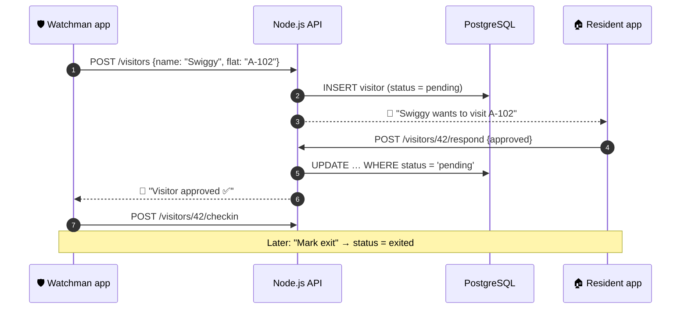

**Pre-approved guests** skip the waiting step entirely. The resident creates a pass, the guest shows the
QR code at the gate, the watchman scans it, and the resident is notified that their guest has arrived.

---

## 🏗️ Architecture

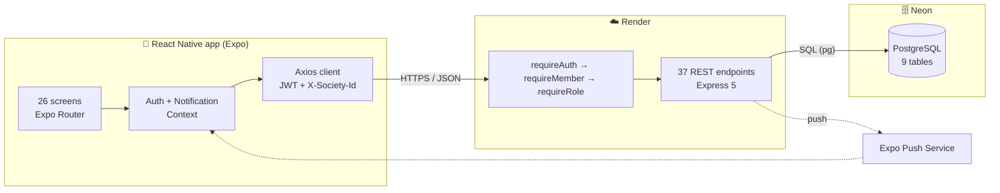

| Layer | Technology | Why |
|---|---|---|
| **Mobile** | React Native 0.88, Expo SDK 58, Expo Router (file-based navigation) | One codebase for Android and iOS |
| **Native features** | Expo Camera (QR scanning), Image Picker, Print (PDF), Sharing, Notifications, Secure Store | Uses the phone's camera, files and notifications |
| **State & data** | React Context and a custom `useApi` hook (load on focus, polling, pull to refresh) | Simple and predictable, with no heavy state library |
| **Backend** | Node.js, Express 5, REST, JWT auth, bcrypt, Multer | Familiar, fast to build, easy to deploy |
| **Database** | PostgreSQL (Neon), raw SQL through `pg`, transactions, JSONB | Relational data with real constraints |
| **Hosting** | Render (API, deployed from `render.yaml`), Neon (database), EAS Build (APK) | Fully deployed on free tiers |

---

## 🧠 Engineering highlights

**1. Multi-tenancy with strict data isolation.**
An *account* is just a person. A *membership* links an account to a society with a **role**, a **flat** and a
**status** (`pending → approved / rejected / removed`). The app sends the current society in an `X-Society-Id`
header, and the `requireMember` middleware rejects the request unless the user is an *approved* member of
*that* society. Every query is then filtered by `society_id`. I tested this end to end: a user from Society A
gets `403` or `404` when trying to read Society B's visitors, bills or notices.

**2. Rules enforced by the database, not just by the code.**
- `UNIQUE (user_id, society_id)`: one membership per person per society.
- `UNIQUE (society_id, flat, month)`: generating bills twice can never create duplicates. The whole
  month's bills are created in **one `INSERT … SELECT unnest(…) ON CONFLICT DO NOTHING`**.
- `CHECK` constraints on every status column, and foreign keys with `ON DELETE CASCADE`.
- Creating a society and its secretary membership happens in a **transaction**, so both are saved or neither is.

**3. Race conditions handled.**
State changes are conditional updates, for example `UPDATE visitors SET status='inside' WHERE id=$1 AND status='approved'`.
If two family members tap Approve at the same moment, or a QR pass is scanned twice, only one succeeds.

**4. Role-based access on both sides.**
The API checks roles (`requireRole('secretary')`). The app also guards each section: a watchman who
opens a resident URL is redirected to their own screens.

**5. Notifications that also work in Expo Go.**
Every event is written to a `notifications` table *and* sent through Expo Push. The app polls the feed every
6 seconds and shows local notifications, so alerts work even where remote push isn't available (Expo Go on
Android). Tapping a notification **switches to the right society** and opens the related screen.

**6. Stateless server.**
Complaint photos are stored in PostgreSQL (`BYTEA`) behind unguessable 128-bit IDs instead of on disk,
because free hosting wipes the disk on every restart.

**7. Dashboards computed in SQL.**
Dashboard numbers come from single queries using `count(*) FILTER (WHERE …)` and `sum(…)`, not by loading
rows into JavaScript.

---

## 🐞 Problems I solved along the way

| Problem | Root cause | Fix |
|---|---|---|
| Users were randomly **logged out** when the app opened from a notification | A screen requested data before the saved login token was restored. The `401` reply then cleared the brand-new session. | Screens wait until the session is restored, and only a `401` for the **current** token logs you out |
| The "My societies" screen **called the API in an endless loop** | The effect depended on the `user` object, which is recreated on every refresh | Depend on the stable `user.id` instead |
| The backend **couldn't reach the database** on some Wi-Fi networks (`ENOTFOUND`) | Some ISP DNS servers can't resolve the database host | Fall back to public DNS and connect by IP, while **TLS still verifies the real hostname** (SNI + certificate check) |
| Dates shifted by one day | `pg` turns `DATE` columns into JavaScript `Date` objects in local time | A custom type parser returns `DATE` as plain `YYYY-MM-DD` strings |

---

## 📂 Project structure

```
society-app/
├── mobile/                  React Native app (Expo)
│   └── src/
│       ├── app/             26 screens, file-based routing (resident/, watchman/, secretary/, society/ …)
│       ├── components/      Reusable UI: Button, Card, StatusBadge, VisitorCard, RoleTabs …
│       ├── context/         AuthContext (session + memberships), NotificationContext
│       ├── hooks/useApi.js  Data loading with polling and refresh
│       └── utils/           PDF receipts, notifications, ₹ formatting, secure storage
├── backend/                 Node.js + Express REST API
│   └── src/
│       ├── schema.sql       9 tables with constraints and indexes
│       ├── auth.js          JWT + requireAuth / requireMember / requireRole
│       ├── routes/          auth, societies, society, visitors, bills, complaints, notices …
│       └── db.js            PostgreSQL pool, transactions, DNS fallback
├── docs/                    Setup guide and screenshots
└── render.yaml              One-click deployment of the API
```

---

## 📱 Try it yourself

**Android app:** [Download the APK](https://expo.dev/accounts/atharva269/projects/society-manager/builds/dcaf0c72-e2bb-4474-893a-4f2b7b9b6853) *(install it and allow "unknown apps")*

**Demo society:** *Shanti Kunj CHS*, join code **`123456`**. Every demo password is **`123456`**.

| Log in as | Email |
|---|---|
| 💼 Secretary | `secretary@demo.com` |
| 🛡️ Watchman | `watchman@demo.com` |
| 🏠 Resident (flat A-102) | `priya@demo.com` |

> The login screen also has **one-tap demo buttons**. Or create your own account and your own society.
>
> The API runs on Render's free tier, so if nobody has used it for a while, the **first request takes about 50 seconds** while the server wakes up.

Want to run it locally or deploy your own copy? See the **[Setup & Developer Guide](docs/SETUP.md)**.


---


